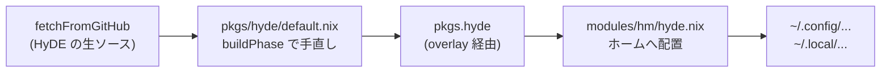

# 03. HyDE を NixOS 向けにパッケージ化する

対象ファイル: [`pkgs/hyde/default.nix`](../pkgs/hyde/default.nix)

## 何が問題なのか

HyDE はもともと Arch Linux 用の設定集なので、そのまま NixOS に持ってくると主に次の 5 つの理由で動きません。

| 問題 | 具体例 |
|-----|-------|
| プロセス名が違う | NixOS はラッパー経由で起動するので、実プロセス名が `.waybar-wrapped` になる |
| 設定がシンボリックリンク | `find` がリンクをたどらず、設定ファイルを見つけられない |
| バイナリの入手方法が違う | Arch は `pacman` やインストーラが前提。NixOS では Nix パッケージを使う |
| Python と Lua の環境が存在しない | 実行時に `uv` で作る venv と `luarocks` で作る Lua の環境が前提だが、NixOS では誰もそれを作らない |
| アーカイブが未展開 | アイコンや GTK テーマ、GRUB テーマが `.tar.gz` のまま同梱されている |

`buildPhase` は、これらを 1 つずつ解消していく処理です。あわせて、HyDE 自体の不具合（Hyprland の Lua 設定に追いついていない箇所など）もここで直しています。

HyDE のファイルの書き換えには、置換元の文字列を指定する `substituteInPlace --replace-fail` か、それを複数のファイルにかける `replaceInFiles`（(2) で説明）を使います。HyDE を更新して置換元の文字列が消えると、ビルドが失敗して気づけます。

## buildPhase がやっていること

### (1) 不要なファイルの削除

```bash
rm -rf Source/assets                        # 素材フォルダ（実行時に不要・容量が大きい）
rm -rf Configs/.local/lib/hyde/resetxdgportal.sh
rm -rf Configs/.local/bin/hydectl
rm -rf Configs/.local/bin/hyde-ipc
rm -rf Configs/.local/lib/hyde/hyq
rm -rf Configs/.local/bin/hyq
```

`hydectl` / `hyq` は、HyDE に同梱されているものではなく**Nix パッケージとして別途ビルドしたバイナリ**を使います（`pkgs/hydectl` と `pkgs/hyprquery` に定義があります）。そのため同梱版を削除して、確実に Nix 版が使われるようにしています。`hyde-ipc` は上流で使われなくなったので、同梱版を消すだけで Nix 版は用意していません。

`resetxdgportal.sh` は、あとで [`modules/hm/hyde.nix`](../modules/hm/hyde.nix) が空のスクリプトに差し替えます。NixOS では XDG ポータルを systemd が管理するので、 HyDE 側の再起動処理は邪魔だからです。

### (2) プロセス名の置換

```bash
find . -type f -print0 | replaceInFiles 'killall waybar' 'killall .waybar-wrapped'
find . -type f -print0 | replaceInFiles 'pgrep -x waybar' 'pgrep -x .waybar-wrapped'
find . -type f -print0 | replaceInFiles '"-x", "waybar"' '"-x", ".waybar-wrapped"'
```

NixOS では、多くのプログラムが「環境変数を設定してから本体を呼ぶ」ラッパースクリプト経由で起動されます。このとき実プロセス名が `.waybar-wrapped` のように先頭ドット付きになります。

HyDE のスクリプトは `killall waybar` や `pgrep -x waybar`（`waybar.py` では `"-x", "waybar"`）でバーを探しますが、NixOS ではその名前のプロセスが存在しないため失敗します。そこで置換して名前を合わせています。対象は waybar / dunst / kitty / swaync の 4 つです。

swaync だけは `killall` ではなく `pgrep -x swaync` で生存確認をしており、置換対象もそちらです。ここが漏れていると waybar の通知モジュールが常に「swaync は起動していない」と判断し、クリックしても通知センターが開きません（[santamn/hydenix#9](https://github.com/santamn/hydenix/pull/9)）。

`replaceInFiles` は `buildPhase` の冒頭で定義している関数です。標準入力で受け取ったファイルのうち置換元の文字列を含むものに `substituteInPlace --replace-fail` をかけ、どのファイルにも含まれていなければ失敗します（`''${` は Nix の `''` 文字列の中で `${` を書くためのエスケープです → [02](./02-nix-basics.md)）。

```bash
replaceInFiles() {
  local -a files
  mapfile -d "" files < <(xargs -0r grep -lIZF -- "$1")
  if [ ''${#files[@]} -eq 0 ]; then
    echo "no HyDE file contains '$1'" >&2
    return 1
  fi
  substituteInPlace "''${files[@]}" --replace-fail "$1" "$2"
}
```

### (3) find のシンボリックリンク対応

```bash
find . -type f \( -executable -o -name "*.sh" \) -print0 | replaceInFiles 'find "' 'find -L "'
```

home-manager は設定ファイルを Nix ストアへのシンボリックリンクとして配置します。 `find` はデフォルトではリンクをたどらないため、HyDE のスクリプトがテーマや壁紙を見つけられなくなります。`-L` オプションを付けてリンク先を追跡させます。

> [!NOTE]
> 本家は実行ファイルだけを対象にしていましたが、このフォークでは `*.sh` も対象に追加されています（`-o -name "*.sh"`）。

### (4) 個別の不具合対応

本家では行番号を決め打ちして `sed` で行を削除していましたが、 HyDE 本体を更新すると意図しない行を消してしまいます。このフォークでは行番号を使わず、置換元の文字列を `substituteInPlace --replace-fail` に渡して書き換えます。

| 対象 | 直していること |
|---|---|
| `hyde-shell` / `reload.py` | Nix で用意した Python と Lua の環境を使わせる（(5)） |
| `luautils/selector/common.lua` | 同名のプリセットがあるとき、最初に読んだディレクトリのものを残す。HyDE のままだと `~/.config/hypr` の overrides が `~/.local/share/hypr` の HyDE のプリセットに負ける |
| `open.lua` | SUPER+B/C/E で起動するアプリに `LUA_PATH` / `LUA_CPATH` を引き継がない。引き継ぐと、そのアプリから起動した LuaJIT のプログラムが Lua 5.5 用のモジュールを読み込む |
| `screenshot.sh` / `screenrecord.sh` | HyDE のインストーラがダウンロードする grimblast の代わりに、nixpkgs の `grimblast` を使う |
| `hypridle.conf` / `hyde-shell` / `custom-power.jsonc` / `custom-powermenu.jsonc` | `hyprctl dispatch dpms off`・`on` と `hyprctl dispatch exit 0` を Lua の書き方に直す。Lua の設定では hyprlang の書き方の dispatch が失敗する（HyDE の master にある修正の先取り） |
| `key_binds.lua` | Alt+Tab の bind に `non_consuming = true` を足し、Alt 単独の押下と解放を fcitx5 などの入力メソッドが受け取れるようにする |
| `swaync/style.css` | 最後の `@import` に無いセミコロンを足し、読み込むたびに GTK が出す警告を止める |

このほか、`patches` で `cpuinfo-tooltip.patch` と `sensorsinfo-tooltip.patch` を当て、waybar のツールチップ（CPU 温度の並び順、電力と電流の見出し、色分けなど）を直しています。

### (5) Python と Lua の環境の差し替え

```bash
find . -type f -print0 | replaceInFiles ${lib.escapeShellArg "\${XDG_STATE_HOME:-$HOME/.local/state}/hyde/python_env/bin/python"} ${hydePython}/bin/python
```

HyDE の Python スクリプトは、実行時に `uv` が `$XDG_STATE_HOME/hyde/python_env` へ作る venv を前提にしています。NixOS ではその venv を作る処理が動かないので、置換しなければ `hyde-shell`（`run_command`）・`gpuinfo.sh` の AMD 分岐・`gamelauncher.sh` が存在しないパスを `exec` して何も出力せずに終了します。

そこで `hydePython` 引数（既定は `inotify-simple` / `loguru` / `pulsectl` / `pygobject3` / `pywayland` / `requests` / `xdg-base-dirs` と `pyamdgpuinfo` を入れた `python3`）を用意し、venv のパスをすべてこれに置換しています。ライブラリを足したり減らしたりしたい場合は、この引数を `overrideAttrs` ではなく `callPackage` の引数として差し替えてください（[santamn/hydenix#8](https://github.com/santamn/hydenix/pull/8)）。`hyde-shell` の `python_activate` も先頭で `return 0` するように書き換え、uv の venv を有効化したり作ったりしないようにしています。

Lua も事情は同じです。HyDE は Lua スクリプト（各種セレクタや `open.lua` など）が使うライブラリを、実行時に `luarocks` で `~/.local/state/hyde/lua_env` へ入れます。`hyde-shell` はこのディレクトリが無いと終了するので、`l_env` を `hydeLua` 引数に向けています。`hydeLua` の既定は、Hyprland が組み込んでいる Lua 5.5 に `argparse` / `dkjson` / `lgi` / `luafilesystem` / `luasocket` を入れた環境です。lgi は GLib を typelib 経由で読むので、ラッパーで `GI_TYPELIB_PATH`、GSettings のスキーマを含む `XDG_DATA_DIRS`、dconf の GIO モジュールを指す `GIO_EXTRA_MODULES` を足しています。`hydeLua` は `buildInputs` にも入っているので、Lua スクリプトのシバンは `fixupPhase` で `hydeLua` の `lua` に書き換わります。

`hyde-shell reload` は uv と luarocks で環境を作り直そうとするので、`reload.py` から `python` と `lua` の項目を消しています。

### (6) アーカイブの展開

```bash
mkdir -p $out/share/grub/themes
tar xzf ./Source/arcs/Grub_Retroboot.tar.gz -C $out/share/grub/themes
tar xzf ./Source/arcs/Grub_Pochita.tar.gz -C $out/share/grub/themes
```

GRUB テーマとアイコン、GTK テーマを `$out/share/` 以下に展開します。これにより、他のモジュールから次のように参照できるようになります。

```nix
# modules/system/boot.nix
theme =
  pkgs.hyde
  + "/share/grub/themes/"
  + (
    if cfg.grubTheme == "Pochita"
    then "Pochita"
    else "Retroboot"
  );

# modules/hm/hyde.nix
".local/share/icons/Wallbash-Icon".source = "${pkgs.hyde}/share/icons/Wallbash-Icon";
```

フォントと VS Code 拡張は `pkgs/hyde` では扱わず、次の場所から入れています。

| 素材 | 入手先 |
|---|---|
| フォント | [`modules/hm/hyde.nix`](../modules/hm/hyde.nix) の `home.packages` で nixpkgs から（`maple-mono` / `nerd-fonts.*` / `noto-fonts-cjk-sans`） |
| VS Code の wallbash 拡張 | [`pkgs/code-wallbash.nix`](../pkgs/code-wallbash.nix) が `HyDE-Project/code-wallbash` をビルドし、[`modules/hm/editors.nix`](../modules/hm/editors.nix) が `.vscode/extensions/thehydeproject.wallbash` に置く |

拡張のディレクトリ名が `thehydeproject.wallbash` なのは、HyDE の `code.sh` が `*extensions/thehydeproject*` に一致するパスを探すからです。

### (7) installPhase と postInstall

```bash
mkdir -p $out
cp -r . $out
```

手直し済みのソースツリー全体を `$out` にコピーします。これにより `${pkgs.hyde}/Configs/...` という形で、 HyDE の元のディレクトリ構造をそのまま参照できるようになります。

さらに `postInstall` で `hyde-shell` の 1 行目（シバン）の直後に `export PATH=...` を挿し込み、`hydePython` / `hydeLua` / `app2unit` / `which` を `PATH` に載せています。`app2unit` は `hyde-shell app` が起動するコマンドをすべて実行するもので、HyDE ではインストーラがスクリプトの隣にダウンロードします（リポジトリには無い）。`which` は、`hyde-shell` が自分のディレクトリを調べるのに使います。

ここで `wrapProgram` を使ってはいけません。`hyde-shell` は実行されるだけでなく、`hyprsunset.sh` / `hyprlock.sh` / `wallpaper.mpvpaper.sh` や wallbash のスクリプト（`code.sh` / `cava.sh` / `dunst.sh`）から `source "$(which hyde-shell)"` の形で読み込まれます。`wrapProgram` が生成するラッパーは最後に `exec` で本体へ処理を渡すため、`source` した側のプロセスがそこで置き換わり、これらのスクリプトは 1 行目で終了します。スクリプト自身に環境を埋め込む形にしているのはこのためです（[santamn/hydenix#7](https://github.com/santamn/hydenix/pull/7)）。

`passthru.hydePython` は、[`modules/hm/waybar.nix`](../modules/hm/waybar.nix) がビルド時に HyDE の `waybar.py` を実行して `includes.json` を生成するのに使います。

## 完成したパッケージの構造

```text
/nix/store/xxxx-hyde/
├── Configs/                    ← HyDE の元のディレクトリ構造そのまま
│   ├── .config/hypr/...        ←   各モジュールが source / readFile で参照する
│   ├── .local/lib/hyde/...     ←   スクリプト群
│   └── ...
└── share/                      ← buildPhase で展開したもの
    ├── grub/themes/
    ├── icons/
    └── themes/
```

## 参照される流れ



## HyDE を更新するときの手順

`pkgs/hyde/default.nix` の `rev` を書き換えるのが基本ですが、 HyDE はスクリプトの塊なので、更新すると動かなくなりやすい部分があります。ふだんは HyDE の新しいタグを renovate が見つけ、2 の書き換えまで済ませた PR を作ります。

1. `nix run .#hyde-diff-upstream` で上流の変更を確認する
2. `rev` を書き換え、`nix run .#update-hashes` で `hash` を計算し直す（`version` は `rev` から導かれるので触らない）
3. `nix run .#hyde-diff-home` で、自分のホーム構成に配置されないファイルが増えていないか確認する（新しい設定ファイルが追加されていたらモジュール側の追従が要る）
4. VM (`nix run .`) で動作確認する

置換元の文字列が新しい HyDE から消えていれば、2 の後のビルドが `replaceInFiles` か `substituteInPlace --replace-fail` で失敗します。その置換がまだ要るかを差分で確かめ、要るなら置換元を書き直し、要らなければ置換ごと消します。

`hyde-diff-upstream` が比べる master 側は、master 上の commit で固定してあります。`update-branch-pins.yml` が毎週日曜にその commit を先頭へ進めるので、比較相手は最大 1 週間遅れの master です（[07](./07-reading-notes.md) の 6）。

## 覚えておくとよいこと

- HyDE の設定ファイルの実体は必ず `pkgs.hyde` の中にある。`~/.local/lib/hyde/theme.switch.sh` を見ても、実体は `/nix/store/...` へのリンクになっている
- リンク先を編集しても意味がない
  - 読み取り専用なので編集できない。設定を変えたいときは Nix 側のオプションを使う → [06](./06-hyprland-modules.md)
  - `mutable` 指定のファイルは例外でコピーを作っているので編集できる → [04](./04-mutable-files.md)
