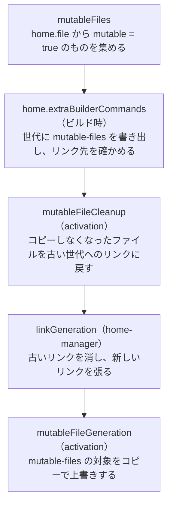

# 04. `mutable` オプション — hydenix の中心となる仕組み

対象ファイル: [`modules/hm/mutable.nix`](../modules/hm/mutable.nix)

hydenix でいちばん理解しづらく、かついちばん重要な仕組みです。

## 前提: home-manager の通常の動き

home-manager で設定ファイルを配置すると、こうなります。

```nix
".config/MangoHud/MangoHud.conf".source = "${pkgs.hyde}/Configs/.config/MangoHud/MangoHud.conf";
```

```text
~/.config/MangoHud/MangoHud.conf
  → /nix/store/xxxx-home-manager-files/.config/MangoHud/MangoHud.conf
    → /nix/store/yyyy-hyde/Configs/.config/MangoHud/MangoHud.conf
```

シンボリックリンクであり、リンク先の Nix ストアは読み取り専用です。これは Nix の設計思想そのもので、次の利点があります。

- 設定を再現できる（同じ入力なら必ず同じ結果になる）
- 変更点が Nix のコードに集約される
- ロールバックが確実にできる

## 問題点: HyDE は設定ファイルを書き換える

ところが HyDE は、テーマを切り替えるときにシェルスクリプトが設定ファイルを書き換えるという前提で作られています。

例：

```text
theme.switch.sh を実行
  → 壁紙の画像から色を抽出 (wallbash)
    → ~/.config/kdeglobals を書き換え
    → ~/.config/kitty/theme.conf を書き換え
    → ~/.config/dunst/dunstrc を書き換え
    → ... (十数個のファイル)
```

リンク先の Nix ストアは読み取り専用なので、リンクを開いてそのまま書き込む処理は Permission denied で失敗します。たとえば `hyprlock.sh` は `hyprlock.conf` を `>` のリダイレクトで書き直します。wallbash のように一時ファイルを `mv` で置き換える処理なら書き込めますが、リンクが実ファイルに置き換わるので、次の rebuild で home-manager がリンクを張り直すときに上書きされるか（`force = true`）、既存ファイルとの衝突で止まります。

## 解決策: `mutable` オプション

`mutable.nix` は home-manager の `home.file` / `xdg.configFile` / `xdg.dataFile` に `mutable` というオプションを後付けしています。

```nix
".config/kitty/theme.conf" = {
  source = "${pkgs.hyde}/Configs/.config/kitty/theme.conf";
  force = true;      # mutable を使うときは必須
  mutable = true;    # ← これ
};
```

`mutable = true` を付けると、リンクではなくコピーとして配置され、書き込み権限が付きます。設定から外せば、普通のリンクと同じく次の rebuild でホームから消えます。

```text
【通常】 ~/.config/MangoHud/MangoHud.conf → /nix/store/... （リンク・読み取り専用）
【mutable】~/.config/kitty/theme.conf       （実ファイルのコピー・書き込み可能）
```

## 仕組み（コードの読み方）

`mutable.nix` は前半 (`options`) と後半 (`config`) に分かれています。

### 前半: オプションを生やす

```nix
mutableOption = lib.mkOption {
  type = lib.types.attrsOf (lib.types.submodule {
    options.mutable = lib.mkOption {
      type = lib.types.bool;
      default = false;
      ...
    };
  });
};
```

```nix
options = {
  home.file = mutableOption;
  xdg.configFile = mutableOption;
  xdg.dataFile = mutableOption;
};
```

`mutable` だけを持つ submodule の型を 1 つ作り、3 つのオプションに同じものを宣言しています。モジュールシステムは同じオプションの submodule 定義をマージするので、 `home.file` の他の性質（`source` や `force` など）は home-manager 本体の定義のまま残り、そこに `mutable` だけが足されます。

対象を集めるときは `home.file` だけを見ます。home-manager は `xdg.configFile` と `xdg.dataFile` を `home.file` に合流させるので、これで 3 つのオプションの分がすべて拾えます。

```nix
mutableFiles = lib.filter (file: file.enable && file.mutable) (lib.attrValues config.home.file);
```

### 後半: 一覧を残し、片付けてからコピーする

後半は、`force` を確かめる assertion（後述）と、次の流れを作る 3 つの設定からなります。



#### 世代に一覧を残す（mutable-files）

```nix
home.extraBuilderCommands = let
  manifest = pkgs.writeText "mutable-files" (lib.concatLines (map (file: file.target) mutableFiles));
in ''
  ln -s ${manifest} $out/mutable-files
  ...
'';
```

`home.extraBuilderCommands` は、home-manager が世代のディレクトリ（`$out`）を組み立てるときに実行するコマンドです。ここで、この世代でコピーする対象の一覧を `mutable-files` として世代に置きます。中身は 1 行に 1 つ、ホームからの相対パス（`target`）です。この一覧を読むのは、同じ世代の `mutableFileGeneration` と、次の世代の `mutableFileCleanup` です。

#### リンク先の確認（checkMutableLinks）

同じ `extraBuilderCommands` の中で、一覧の各対象の下にあるリンクをすべて `realpath -m` で解決します。解決先が Nix ストアの中の存在するパスでなければ、ファイル名と解決先を表示してビルドを失敗させます。

コピーは `cp -L` でリンクをたどるので、コピーの中身が世代だけで決まるのは、どのリンクもストアの中の存在するパスを指しているときに限られます。リンク先がストアの外（`mkOutOfStoreSymlink` など）なら、activation を実行するマシンにあるものがコピーされます。リンク先が存在しなければ `cp` が失敗し、`linkGeneration` がホームのリンクを張り替えた後で activation が止まります。こうした世代はビルドの段階で失敗するので、ビルドできた世代にはどれでもロールバックできます。

#### 外したコピーを片付ける（mutableFileCleanup）

```nix
home.activation.mutableFileCleanup = lib.hm.dag.entryBetween ["linkGeneration"] ["writeBoundary" "checkFilesChanged"] ''
```

`linkGeneration` の前に、置き換えられる世代（`$oldGenPath`。ふだんは前回の世代）の `mutable-files` を読み、そこに載っている対象の下のファイルをその世代のツリーから 1 つずつ取り出します。ホームにあるのがリンクでない実ファイルなら、次のように扱います。

- 新しい世代でも同じ対象が mutable なら、後のコピーで上書きされるので触らない
- 新しい世代ではリンクになっていて、ホームのコピーが新しい中身と違う（手で書き換えた）なら触らず、home-manager の衝突チェックに任せる
- それ以外（新しい世代に無い、または中身が同じままリンクに変わった）なら、古い世代へのリンクに戻す（`run ln -sf $VERBOSE_ARG "$oldSource" "$HOME/$path"`）

古い世代へのリンクに戻したファイルは、`linkGeneration` が普通のリンクと同じように扱います。新しい世代に無ければ古いリンクとして削除し、新しい世代でリンクになっていれば張り直します。新しい世代に無いファイルは、手で書き換えた内容があっても一緒に消えます。コピーをここで直接消さないのは、`linkGeneration` が古い世代のファイルを片付けるときに、世代へのリンクでないパスごとに警告を出すからです。

取り出すのは置き換えられる世代のツリーにあるファイルだけなので、`recursive` の対象の中に利用者や HyDE があとから置いたファイルには触りません。置き換えられる世代に `mutable-files` が無いとき（初めて activation するときなど）は何もしません。

ロールバックのときは、home-manager は置き換えられる側、つまり新しいほうの世代を `$oldGenPath` に入れます。そのため同じ処理で、戻り先の世代に無いコピーが消えます。

#### コピーで上書きする（mutableFileGeneration）

```bash
function copyMutableFiles() {
  echo "Copying mutable home files for $HOME"

  local target
  while IFS= read -r target; do
    # -T merges a recursive target into the directory linkGeneration made.
    run cp -rLT --remove-destination "$newGenPath/home-files/$target" "$HOME/$target"
    # The store's modes are read-only.
    run chmod -R u+w "$HOME/$target"
  done < "$newGenPath/mutable-files"
}
```

| オプション | 意味 |
|----------|------|
| `-r` | ディレクトリ（`recursive = true` の対象など）を中身ごとコピーする |
| `-L` | 世代のツリーはリンクなので、リンク先の中身をコピーする |
| `-T` | コピー先をそのパス自体として扱い、`linkGeneration` が作ったディレクトリにマージする |
| `--remove-destination` | 既にあるシンボリックリンクを消してから書く（これが無いとリンク先に書こうとして失敗する） |

コピー元は、世代の `home-files` の中にある各対象です。`text` で中身を書いたファイルも世代の中では普通のファイルなので、`source` で指定したものと同じようにコピーされます。

Nix ストアのファイルは読み取り専用なので、コピーした後に `chmod -R u+w` で書き込み権限を付けます。実行権限は `cp` がコピー元から引き継ぐので、世代の中で実行可能なファイルはコピーしても実行可能なままです。

`run` は home-manager が用意しているシェル関数で、dry-run のとき（`DRY_RUN` が設定されているとき）はコマンドを実行せずに表示します。

### 実行順序

```text
writeBoundary / checkFilesChanged
  → mutableFileCleanup     （コピーしなくなったファイルを古い世代へのリンクに戻す）
  → linkGeneration         （古いリンクを消し、新しいリンクを張る）
  → mutableFileGeneration  （mutable なものだけコピーで上書きする）
  → setTheme など          （entryAfter ["mutableFileGeneration"]）
```

home-manager の activation は依存グラフで順序が決まります。 `mutableFileGeneration` を `linkGeneration`（シンボリックリンクを張る処理）の**後**に実行することで、「まずリンクを張る → mutable なものだけコピーで上書きする」という順序を保証しています。

`theme.nix` の `setTheme` や `hyde.nix`、`hyprland/` の各モジュールの activation は、`entryAfter ["mutableFileGeneration"]` でコピーの後に実行されます。home-manager の依存グラフは知らない依存名を警告もなく無視するので、エントリ名を変えるときは参照する側も直す必要があります。

## `force = true` が必須な理由

```nix
assertions =
  map (file: {
    assertion = file.force;
    message = "${file.target}: `mutable = true` requires `force = true`";
  })
  mutableFiles;
```

`force = false` のままだと、home-manager は既存ファイルがあるときにリンク作成を中断し、ファイルが既に存在するというエラーを出します。mutable ファイルは前回の rebuild でコピーされた実ファイルが必ず存在します。そのため `force = true` で「既存を上書きしてよい」と明示しておかないと、リンク作成が中断されます。assertion のメッセージには、`force` の無いファイルのパスが入ります。

## トレードオフ

| | 通常（リンク） | mutable（コピー） |
|-|-------------|------------------|
| 書き込み | 不可 | 可能 |
| 再現性 | 完全 | 実行時に変化しうる |
| rebuild したとき | リンクを張り直す | コピーし直す（実行時の変更は消える） |
| 設定から削除したとき | 自動で消える | 自動で消える（書き換えた内容も消える） |
| ディスク使用量 | 少ない（共有） | 多い（実体を持つ） |
| ロールバック | 確実 | 戻り先の世代の内容でコピーし直す |

片付けの対象は、世代がコピーしたファイルだけです。HyDE のスクリプトが実行時に作ったファイル（`~/.cache/hyde` の中身や、mutable なディレクトリにあとから増えたファイル）はどの世代にも含まれないので、設定を変えても残ります。古い状態が悪さをしている場合は手動で削除してください。

```bash
# 例: テーマ関連の状態をリセットしたい場合
rm -rf ~/.config/hyde ~/.local/share/hyde ~/.cache/hyde
# その後 nixos-rebuild switch で再配置される
```

`nixos-rebuild switch` が home-manager の activation を実行し直すのは、home-manager の世代が変わったときだけです。設定を何も変えていなければ `home-manager-<ユーザー名>.service` は再起動されないので、そのときは `sudo systemctl restart home-manager-<ユーザー名>.service` で activation をやり直します。

## どのファイルが mutable なのか

コード中で `mutable = true;` を検索すると分かります。

```bash
grep -rn "mutable = true" modules/hm/
```

おおよそ次の性質を持つファイルです。

- wallbash が書き込む配色ファイル（kitty の `theme.conf` / rofi の `theme.rasi` など）
- テーマ切り替えで書き換わる設定（`dunstrc` / `kdeglobals` / `gtk-3.0/settings.ini`）
- アプリが自分で書き換える設定（`hyde/config.toml` / VS Code の `settings.json`）
- HyDE のデータ（`~/.local/share/hyde` / `~/.config/hyde/wallbash`）
- Hyprland の `hypridle.conf` / `hyprlock.conf` / `hyprsunset.conf`（`mkHyprConfig` が生成するもの全部。後述）と `~/.config/hypr/hyprlock/`

> [!IMPORTANT]
> **フォークでの変更点**: `mkHyprConfig` が生成する設定はすべて `mutable = true` です。オリジナルの hydenix では `monitors.conf` だけが mutable で、`keybindings.conf` などはリンクでした。
>
> つまり `hypridle.conf` / `hyprlock.conf` / `hyprsunset.conf` は、いまはコピーとして配置され、HyDE 側のスクリプト（`hyprlock.sh` のレイアウト切り替えなど）が書き換えられます。モジュールを無効化すると、ほかの mutable なファイルと同じく次の rebuild でホームから消えます。

## 自分の設定で mutable なファイルを上書きしたいとき

mutable なファイルにコピーされるのは、世代の `home-files` にある中身です。利用者が自分の設定で同じパスを書いた場合も、どちらの定義を世代に入れるかを home-manager が決め、その結果がそのままコピーされます。この結果は `mutable = true` の有無で変わりません。

たとえば waybar の clock モジュールを差し替えようとして次のように書いても、反映されません。

```nix
# 反映されない（mutable = true を足しても同じ）
home.file.".config/waybar/modules/clock.jsonc" = {text = ...; force = true;};
```

`modules/hm/waybar.nix` が `.config/waybar/modules` を `recursive = true` で配置しており、その中に HyDE の `clock.jsonc` があるからです。ディレクトリごと再帰的に張ったリンクと個別に書いたファイルが重なると、home-manager は既定（`home.fileOverlapResolution = "ignore"`）ではディレクトリ側のファイルを残し、個別に書いたほうを無視します。そのため次のどちらかで対処します。

1. `home.fileOverlapResolution = "override";` を設定して、個別に書いたファイルを優先させる（home-manager のドキュメントには載っていない実験的なオプション）
2. 参照元（例: waybar の `includes.json`）を書き換えて、独自パスを指させる
