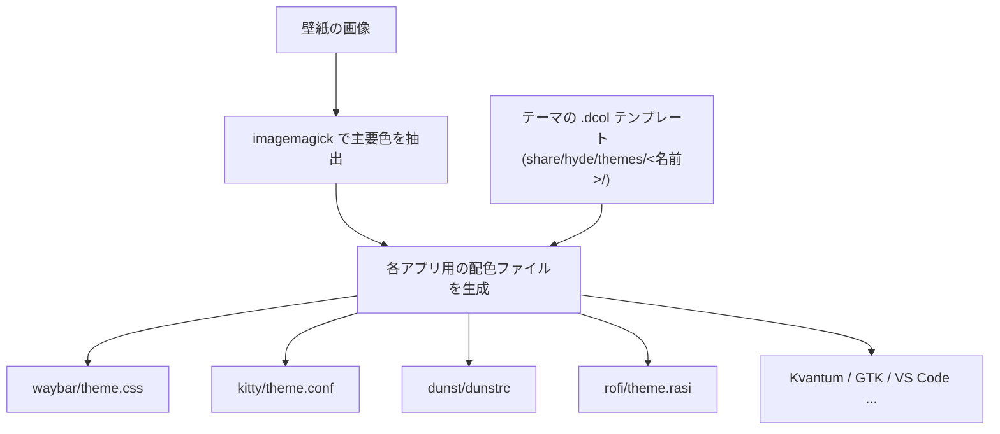
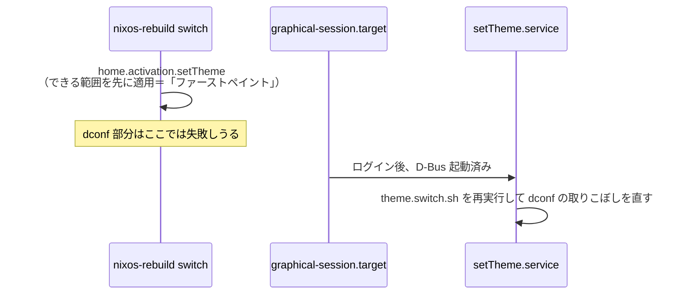

# 05. テーマシステムと wallbash

対象ファイル: [`modules/hm/theme.nix`](../modules/hm/theme.nix) / [`pkgs/hydenix-themes/`](../pkgs/hydenix-themes/) / [`pkgs/hydenix-theme-assets.nix`](../pkgs/hydenix-theme-assets.nix)

## 全体像

hydenix のテーマは2層に分かれて管理されています。

| 層 | 何をするか | 担当 |
|----|----------|-----|
| **テーマ** | 壁紙・配色・アイコン・フォントのセット | `pkgs/hydenix-themes/` |
| **wallbash** | 現在の壁紙から色を抽出し各アプリの配色を自動生成 | HyDE 本体のスクリプト |

## パート1: テーマのパッケージ化

### テーマの定義

各テーマファイルは、すべて同じ形をした小さなデータファイルです。

```nix
# pkgs/hydenix-themes/Decay-Green.nix
{pkgs, mkTheme}:
mkTheme rec {
  name = "Decay Green";
  branch = "Decay-Green";   # 追っているブランチ（1 リポジトリにテーマをブランチ別に置いている場合だけ）
  src = pkgs.fetchFromGitHub {
    owner = "HyDE-Project";
    repo = "hyde-themes";
    rev = "b5daf8e2717cdac23fcd3a7909869130b2877049";   # コミットで固定
    inherit name;
    sha256 = "sha256-Vg9WsRPrkpkQMtOT+8rjf7CKiCvTQ12XZYX6hfUU0h0=";
  };
  meta = {description = "..."; homepage = "...";};
}
```

`rev` は commit で固定したまま、`update-branch-pins.yml` が毎週日曜に `branch` の先頭へ進めます。`branch` を書いていないテーマ（テーマ専用リポジトリの 37 個）はリポジトリの既定ブランチを追います。`branch` は更新ツールが読むだけの情報なので、`mkTheme` は derivation には渡しません（[10](./10-ci.md)）。

### mkTheme.nix によるビルド

[`utils/mkTheme.nix`](../pkgs/hydenix-themes/utils/mkTheme.nix) が実際のビルド処理を担当し、次のレイアウトを持つパッケージを作ります。

```text
$out/share/
├── hyde/themes/<テーマ名>/   ← HyDE が読む設定一式（wallbash の色定義など）
├── themes/                   ← GTK テーマ
├── icons/                    ← アイコン・カーソルテーマ
└── fonts/                    ← フォント
```

テーマによって同梱されるものが違うため、`for ... if [ -f ... ]` であるものだけ入れるようにしています。

`dontPatchELF` / `dontRewriteSymlinks` / `dontDropIconThemeCache` は、Nix が実行ファイル向けに行う後処理を無効化する指定です。テーマは素材の集まりなので、これらの処理はむしろ壊す原因になります。

テーマの `wall.set` と `wall.<バックエンド>.png` は、パッケージから消しています。これらは HyDE がテーマごとに選んだ壁紙を記録するリンクで、一部のテーマは作者のマシン上のパスを指すリンクのままコミットしています。mutable のコピーはリンクをたどるので、ストアの外を指すリンクがあると世代のビルドが失敗します（[04](./04-mutable-files.md)）。消しておけば、HyDE がテーマの最初の壁紙へのリンクを作ります。HyDE が作ったリンクは世代に含まれないので、rebuild しても選んだ壁紙は残ります。

#### sharedAssets — 同名アイコンテーマの衝突を避ける

テーマの tar.gz には、hydenix が単体パッケージとしても配布しているアイコン・カーソルテーマが含まれていることがあります。たとえば Catppuccin Mocha は `Tela-circle-dracula` を、Vanta Black は `Bibata-Modern-Ice` を同梱しています。hydenix はこの 2 つを HyDE の tar.gz ではなく nixpkgs のソースからビルドし、`modules/hm/hyde.nix` の `home.packages` に入れているため、同じ `share/icons/<名前>` に**中身の違う 2 つのディレクトリ**が生まれます。テーマ同梱のコピーまで `home.packages` に載ると、home-manager の `buildEnv` が衝突を検出してビルドが落ちます。テーマのアイコンが `home.packages` に載るのは、後述の `altIcons` に分けられたときです。

`mkTheme` の `sharedAssets` 引数（キー = 展開先ディレクトリ名、値 = 正準パッケージ）がこれを吸収します。展開後に該当ディレクトリを削除し、正準パッケージへの symlink に張り替えるので、両方の参照が同じストアパスへ解決され `buildEnv` が通ります。テーマは自己完結したままです。

```nix
# pkgs/hydenix-themes/default.nix
mkTheme = import ./utils/mkTheme.nix {
  inherit pkgs;
  sharedAssets = {inherit (pkgs) Bibata-Modern-Ice Tela-circle-dracula;};
};
```

CI では `flake.nix` の `checks.theme-assets` が `Bibata-Modern-Ice` / `Tela-circle-dracula` と、Catppuccin Mocha / Catppuccin Latte から作った `altIcons` を 1 つの `buildEnv` に束ねており、同じ衝突が起きれば PR の時点で落ちます（[santamn/hydenix#10](https://github.com/santamn/hydenix/pull/10)）。

テーマ同士が同じ名前のディレクトリを持つ場合は、`modules/hm/theme.nix` が有効なテーマの素材を束ねるときに扱います（後述の「theme.nix によるインストール」）。

### カタログ

[`pkgs/hydenix-themes/default.nix`](../pkgs/hydenix-themes/default.nix) が「表示名 → パッケージ」の対応表を作り、`pkgs.hydenix-themes` として公開します。

```nix
{
  "BlueSky" = callTheme ./BlueSky.nix;
  "Rosé Pine" = callTheme ./Rose-Pine.nix;   # ← キーとファイル名は一致しない
  "Mac OS" = callTheme ./Mac-OS.nix;
  "Catppuccin-Macchiato" = callTheme ./Catppuccin-Macchiato.nix;  # ← Catppuccin の中でこれだけハイフン
  ...
}
```

> [!IMPORTANT]
> **利用者が書くテーマ名は、このファイルのキーと一字一句一致させる必要があります。**
> ハイフンだったり空白だったり、`Rosé` のようにアクセント付き文字だったりと不規則なので、設定する前に必ず `pkgs/hydenix-themes/default.nix` を確認してください。

### theme.nix によるインストール

```nix
findThemeByName = themeName: pkgs.hydenix-themes.${themeName} or null;
availableThemes = lib.filter (themeName: findThemeByName themeName != null) cfg.themes;
```

`or null` により、**存在しないテーマ名を書いてもビルドは失敗せず、警告も出ずに無視されます**。[`demo/home.nix`](../demo/home.nix) の末尾にある `"Some Theme"` は、この挙動を検証するためのテスト用エントリです。

親切なようですが、タイプミスに気づけないという副作用もあります。テーマが適用されないときは、まず名前のスペルを確認してください。

配置先は `~/.config/hyde/themes/<テーマ名>` で、`mutable = true` が付いています（wallbash がこの中に生成物を書き込むため）。

テーマに同梱されたアイコン・GTK テーマ・フォントは、[`pkgs/hydenix-theme-assets.nix`](../pkgs/hydenix-theme-assets.nix) が有効なテーマの分を 1 つのツリーに束ね、`~/.local/share/{icons,themes,fonts}` に置きます。HyDE の `theme.patch.sh` が展開するのと同じディレクトリです。`recursive = true` でエントリごとにリンクするので、ディレクトリ自体は書き込み可能なまま残り、実行時に取り込んだテーマもここに展開できます。

複数のテーマが同じ名前のディレクトリを持つときは、`theme.patch.sh` と同じく `themes` で先に書いたテーマのものを丸ごと使い、ファイル単位では混ぜません。中身が同じならリンクは 1 つで済みます。中身が違うときの扱いは種類で分かれます。

| 種類 | 中身の違う 2 つ目以降のコピー |
|---|---|
| アイコンテーマ | 2 つ目を `altIcons` に分け、`home.packages` でプロファイルに入れる。3 つ目以降は使わない |
| GTK テーマ・フォント | 使わない（XDG のベースディレクトリをまたいでマージされないので、最初のコピーだけが意味を持つ） |

アイコンテーマは、ベースディレクトリが違えば同じ名前の 2 つのコピーがマージされます。GTK と Qt はどちらもプロファイルを `~/.local/share` より後に探すので、`index.theme` は `~/.local/share/icons` のものが使われます。使わないコピーはビルドログに `[skip]` と出るだけで、ビルドは失敗しません。

## パート 2: wallbash

wallbash は HyDE の目玉機能で、次のように動きます。



生成先のうち kitty の `theme.conf` や rofi の `theme.rasi` などには `mutable = true` が指定されています → [04](./04-mutable-files.md)。ただし wallbash は一時ファイルに書き出してから `mv` で生成先を置き換えるので、`waybar/theme.css` のようにリンクのままの生成先にも書き込めます。

hydenix 側は基本的にHyDE のスクリプトが動く環境を整えるだけで、色を作る処理そのものには関与していません。

## パート 3: テーマ適用のタイミング問題

`theme.nix` で最も分かりにくいのがここです。

### なぜ 2 か所で適用しているのか

テーマ適用スクリプト `theme.switch.sh` から呼ばれる `color.set.sh` は、`color/dconf.lua` で dconf（GNOME 系の設定ストア）に書き込みます。dconf は D-Bus が必要で、D-Bus はグラフィカルセッションと一緒に起動します。一方 `nixos-rebuild switch` の activation script は、セッションが始まる前（あるいはログイン中の別コンテキスト）で実行されます。つまり、初回の rebuild では dconf を使う部分が必ず失敗するのです。

そこで hydenix は2段構えにしています。



| 実行者 | タイミング | 目的 |
|-------|----------|------|
| `home.activation.setTheme` | rebuild 時 | 壁紙や設定ファイルなど、セッション不要な部分を先に適用 |
| `setTheme.service` | ログイン後 | テーマ全体を再適用し、dconf の取りこぼしを直す |

コード中のコメントに「これは Web で言うファーストペイントに近い」とあるのはこの意味です。

dconf の設定も `setTheme.service` が反映します。`setTheme.service` が実行する `theme.switch.sh` が `color.set.sh` を呼び、そこから `color/dconf.lua` が実行されるからです。

### PATH を明示している理由

```nix
export PATH="${lib.makeBinPath (with pkgs; [awww killall hyprland hyprquery dunst ...])}:$HOME/.local/bin:$PATH"
```

activation script は最小限の環境で動くため、`awww` や `imagemagick` などが PATH にありません。`lib.makeBinPath` でパッケージのリストから PATH 文字列を組み立てて明示的に通しています。

systemd サービス側も同様に `Path = [...];` で指定しています。

> [!NOTE]
> 本家ではここが `swww` でした。フォークでは壁紙デーモンが `awww` に変わっています。

### activation に渡しているほかの環境変数

activation の `setTheme` は、`PATH` のほかに 2 つの変数を用意してから `theme.switch.sh` を実行します。

`HYPRLAND_CONFIG` には、`home.sessionVariables` の値（`~/.local/share/hypr/hyde.lua`）をそのまま渡します。`theme.switch.sh` は、この変数が読めるファイルを指しているときだけ、テーマの `hypr.theme` を Hyprland 用の Lua に変換します。渡さないと、テーマの隙間・枠線・ぼかしが、セッション内でテーマを切り替えるまで反映されません。

`XDG_SESSION_DESKTOP` は、`systemctl --user show-environment` の出力から取り込みます。`waybar.py` は waybar のユニット名をこの変数から作ります（`hyde-<XDG_SESSION_DESKTOP の値>-bar.service`、未設定なら `unknown`）。activation の環境にはこの変数が無いので、取り込まないとセッションの waybar を再起動できず、2 本目の waybar を起動してしまいます。

### ログの場所

うまくいかないときは、ここを見てください。

```bash
# activation script のログ
cat ~/.local/state/hyde/theme-switch.log

# systemd サービスのログ
journalctl --user -u setTheme.service
```

## テーマを変更する方法

```nix
# modules/hm/default.nix（利用者側）
hydenix.hm.theme = {
  active = "Tokyo Night";        # 起動時に適用されるテーマ
  themes = [                     # インストールするテーマ（active はここに含める）
    "Tokyo Night"
    "Catppuccin Mocha"
  ];
};
```

> [!TIP]
> `themes` に書いた分だけビルド時間とディスク容量を消費します。`demo/home.nix` は検証目的で全部書いていますが、実利用では 2〜3 個に絞るのが現実的です。

実行中に切り替えたい場合は、HyDE 側の機能（waybar のテーマボタン、`hyde-shell` など）が使えます。ただしその変更は Nix の管理外なので、次の rebuild で `active` の値に戻ります。

## コード中に残っている TODO

`theme.nix` には次の TODO が残っています。

> color.set.sh / color/dconf.lua がやっていることを Nix 側で再現し、gtk/qt などの設定を home.file で直接書き込むようにすればよい

もしこれが実現すれば、activation script、systemd サービス、mutable ファイルのいずれも減らせます。現状は「HyDE のスクリプトをそのまま動かす」方針を取っています。この方針だと HyDE 本体の更新に追従しやすい反面、仕組みは複雑です。
